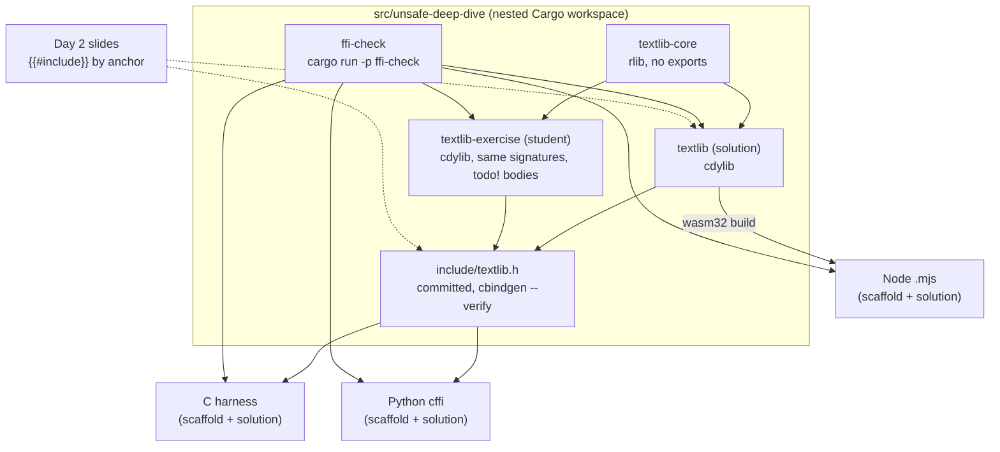
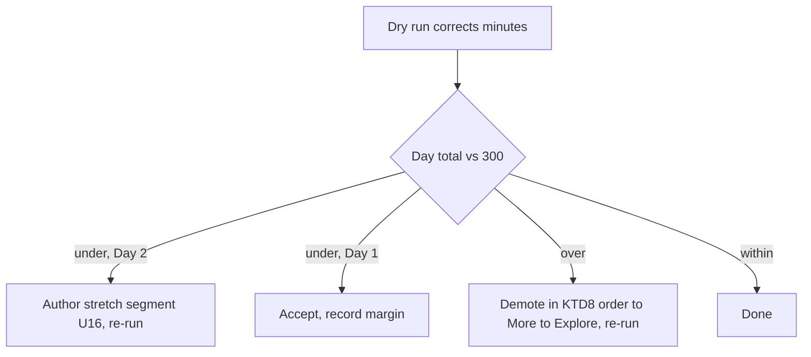

# Unsafe Deep Dive, Two Full Days - Plan

## Goal Capsule

- **Objective:** A facilitator can teach the Unsafe Deep Dive in this fork as two full classroom days, and a student who already has Rust fundamentals leaves able to call their own Rust from a language they have never written, because they learned to read the boundary rather than the language.
- **Means:** Fill the WIP deep dive in upstream's order (KD4). Day 1 is the existing foundations timed and completed. Day 2 is an FFI capstone ported from the facilitator's RustConf 2026 workshop (KD5), built as a nested Cargo workspace with a one-command check (KTD1, KTD2).
- **Authority hierarchy:** Product Contract requirements decide product behaviour; Key Technical Decisions decide mechanism within them; units override neither.
- **Execution profile:** fork-only, on branch `claude/unsafe-deep-dive-plan`, committed incrementally, never pushed to google/comprehensive-rust and no pull request; the facilitator runs the dry run (U15) and decides the stretch segment (U16).
- **Stop conditions:** a change would require editing the root `Cargo.toml`, `MODULE.bazel.lock` or `xtask/src/main.rs` (KTD1); a settled decision proves infeasible; real Advent of Code input or puzzle prose would have to enter the repository (R22).
- **Who finishes:** the implementer lands U1 to U14 and U17; the facilitator performs U15 and chooses whether U16 runs.
- **Product authority:** The facilitator (repository owner). Upstream google/comprehensive-rust is not a stakeholder of this work.
- **Open blockers:** None. Everything unresolved is deferred to planning (see Outstanding Questions).

---

## Product Contract

### Summary

Complete the deep dive to its declared 600-minute target: time every Day 1 slide, write the title-only stubs, wire the six orphan pages, and build Day 2 as an FFI capstone that carries a small text-processing library across four boundaries in turn. Wrap C, export to C, call it from Python over the generated header, and export raw wasm32 functions driven from JavaScript. A bytes-with-a-schema segment is authored as timing buffer only if the dry run leaves Day 2 short of its target.

### Problem Frame

The deep dive declares a 600-minute target in its welcome page, but the slides listed in the table of contents sum to 337 minutes, and 25 of the 77 listed slides carry no timing at all. Six pages are a licence comment and a title. Six written pages are not reachable from the table of contents.

The FFI segment covers one direction only, Rust calling C. Nothing shows Rust exposed to C, a callback handed to C, an error or a panic crossing the boundary, or a safe wrapper over an opaque handle, although the segment's own comparison tables name every one of those. Both FFI exercises end by asking learners to write the safe wrapper and give no model answer.

The facilitator has already built and delivered the missing half as a half-day RustConf workshop: a tested library of Advent of Code solutions crossed into C, Python and three other languages, with the failures that happened recorded as teaching material. That material is puzzle-specific and multi-language, and the course is neither. The cost today is that the facilitator cannot teach two days from this fork, and would have to teach the FFI half from a separate deck and repository with a different setup story.

### Key Decisions

- KD1. **Fork-only target; nothing is pushed.** (session-settled: user-directed — chosen over upstreaming to google/comprehensive-rust: upstreaming needs the CLA and Google headers, and the facilitator wants to teach first.) Governs R31.
- KD2. **The "what crossing costs" benchmark slide stays out.** (session-settled: user-directed — chosen over including it as an optional slide: the numbers are machine-specific and the strategies slide already gestures at cost.)
- KD3. **Two full days against the course's 600-minute target, timed as two 300-minute sessions.** Half-day FFI-only and one-day formats were rejected because the facilitator will have the room for two days; one aggregate total would hide a lopsided split between the days. Governs R1, R2, R18.
- KD4. **Capstone arc, upstream's order.** Day 1 foundations as upstream laid them out, Day 2 FFI, with two forward cross-link slides instead of a boundary-first reorder. Keeps upstream merges cheap and spends authoring where the facilitator has material. Governs R5.
- KD5. **The FFI segment is the RustConf workshop made generic.** C in both directions and Python over the C header are ported from the workshop; raw wasm32 from JavaScript is new authoring with no workshop source. Kotlin, Swift, Dart, Fortran, R and Godot tracks are out; Python and JavaScript are the two most used consumer languages and React Native is more used than Flutter. Governs R6 to R17.
- KD6. **Raw wasm32 exports and linear memory, not wasm-bindgen or the component model.** The raw form has the same shape as the C glue and reinforces the unsafe lessons; the tooling slide names the alternatives. Governs R16, R17.
- KD7. **Python is cffi reading the generated header; PyO3 is named only.** Same header as the C harness, so the lesson stays "read the contract", not "learn a binding generator". Governs R15.
- KD8. **The running example is a ladder: an arithmetic kata as the ground floor, then Advent of Code days chosen for byte-heavy input, used as is and made generic later.** (session-settled: user-directed — chosen over puzzle-only or kata-only examples: the kata proves the boundary carries a value at all, and text is where FFI is hardest.) The days are Mull It Over (2024 day 3), Trebuchet (2023 day 1) and Historian Hysteria (2024 day 1). Governs R20, R22, R23.
- KD9. **Consumer-language code is a scaffold with only the boundary left blank.** The outcome is writing a language you do not know, so students complete Python and JavaScript callers from the header, and solution pages gloss the foreign lines. Governs R20, R21, R24.
- KD10. **Non-FFI segments are timed and their stubs written; no new non-FFI segments.** The facilitator's material covers FFI only. Governs R2, R3, R4.
- KD11. **A tool-agnostic prework setup page with a self-check.** Chosen over Nix-first, install-during-class, and instructor-only toolchain: students install five tools before Day 1 and Nix is mentioned as one route. Governs R27 to R29.
- KD12. **Standard course headers on every new page; no provenance lines.** Chosen over per-page attribution to the facilitator or upstream-ready attribution notes. Governs R30.
- KD13. **The stretch segment is "bytes with a schema": a structured result returned across the boundary as serialised bytes, authored only if the dry run leaves Day 2 under its 300-minute target.** (session-settled: user-directed — chosen over a React Native stretch segment: React Native is specialised enough to be its own deep dive layered on this one, while a serialisation format has libraries in C, Python and JavaScript and makes the byte contract visible.) The format is an open question until the facilitator's poll settles. Governs R18, R19.
- KD14. **Source material is alycda/rustconf2026 on main.** The develop branch's Fortran, R and Godot tracks and the private aoc-ffi-workshop repository are not inputs.

<!-- ce-section: work-relationships -->
### How This Work Fits Together

This plan covers the whole Unsafe Deep Dive in this fork; the breakdown below is the current understanding, not a committed roadmap.

- Facilitator `.cheat` sheets for every course segment, including this deep dive.
  - Can proceed independently of this plan; it reads the finished slides, so it is cheapest after them.
- Making the running example generic (replacing the Advent of Code solvers).
  - Depends on this plan having been taught once; shares R22's publishing rule.
- An upstream contribution to google/comprehensive-rust.
  - Still to decide; depends on KD1 being revisited and on the attribution choice in KD12.

### Actors

- A1. Facilitator: the repository owner, who runs the two days from this fork and performs the dry run.
- A2. Student: has completed Rust Fundamentals or equivalent self-directed training, has not necessarily written Python or JavaScript.

### Requirements

**Course structure and timing**

- R1. The Unsafe Deep Dive is two sessions, Day 1 through Pinning and Day 2 from FFI, each with its own 300-minute target and its own outline, and each day's outline reports a total at or above its target as the tooling counts it, breaks included; the course-structure page's outline directive is corrected to name the course as `welcome.md` declares it, since today it names a course that does not exist and renders nothing.
- R2. Every page listed under the Unsafe section of the table of contents carries a `minutes:` value.
- R3. Each written page not currently reachable from the table of contents is either listed in the segment its content belongs to or folded into that segment's index page, and a page that duplicates a listed page is removed.
- R4. The six title-only pages carry slide content and speaker notes consistent with the segment around them.
- R5. The Initialization and Pinning segments each gain one short cross-link slide pointing forward to the Day 2 moment that depends on them: Initialization to R8's out-parameters written by the callee into caller memory, Pinning to the R13 case where C retains a pointer to Rust-owned state across calls.

**FFI segment content**

- R6. A slide wraps `qsort(3)` to teach a C function pointer type, a Rust-defined callback handed to C, and a slice crossing as pointer plus length plus element size, with the `a - b` comparator overflow as the live beat.
- R7. A slide shows Rust exposed to C: a dynamic library crate, an exported unmangled function, the four-step ingress for a C string, and a header generated from the Rust.
- R8. A slide teaches error reporting across the boundary as status codes and out-parameters, distinguishing input refused by the boundary from failure in the solver.
- R9. A slide teaches that a panic reaching an `extern "C"` frame aborts the process on Rust 1.81 and later (before that it was undefined behaviour), that `extern "C-unwind"` is the ABI that lets a panic cross, that `catch_unwind` is a backstop rather than a guard, and that checked arithmetic is the only overflow guard independent of build profile.
- R10. A slide gives the model answer the two existing exercises lack: an opaque handle wrapped in a type whose destructor frees it, with a hand-freed version shown first for code review.
- R11. A slide shows compiling C from a build script with the `cc` crate behind a feature gate, replacing the setup page's Bazel TODO.
- R12. A slide explains when a C shim is the binding: macro-only libraries, version-renamed symbols, and struct layouts that depend on how the library was built.
- R13. A slide covers ownership of a C library's state across threads, per-handle, process-global, and per-thread scratch, each with the Rust construct that makes it sound, and the mirror case where C retains a pointer to Rust-owned state across calls, which is what the Pinning cross-link points at.
- R14. The type-safety stub becomes a slide on three ways an integer type is wrong at the boundary: wrong width, wrong domain, and no type tag at all.
- R15. A slide and exercise call the exported library from Python through `cffi` using the generated header as the declaration source.
- R16. A slide and exercise export the library as raw wasm32 functions and drive them from JavaScript under Node, passing text in and results out through linear memory with exported allocation functions.
- R17. A tooling slide names the generators by direction: bindgen, cbindgen, cxx and autocxx, UniFFI, PyO3, wasm-bindgen and the component model, and names JSI and TurboModules as the React Native boundary.
- R18. When the dry run leaves Day 2 under its target, a bytes-with-a-schema stretch segment is authored that returns a structured result from the running example as serialised bytes in one format with libraries in C, Python and JavaScript, carries its own `minutes:` values, and is marked as a stretch segment in its speaker notes.
- R19. When the dry run shows the Day 2 total at or above its 300-minute target, the stretch segment is not authored; when it is under, the segment is authored and timed and a second dry run confirms the total. When a day exceeds its target after the dry run, slides are demoted to More to Explore speaker-note material in a named order, starting on Day 2 with R12 (C shims) and R13 (C library state), and F3 records the resulting order.

**Exercises**

- R20. A C-glue exercise has students wrap a running-example solver in an `extern "C"` function, generate the header, and pass a C harness that tests a null pointer and invalid UTF-8 before the happy path.
- R21. The Python and JavaScript exercises provide a runnable scaffold in which only the declaration taken from the generated header and the boundary call are left for the student to write.
- R22. Running-example code and tests use only the short example inputs printed in the chosen days' puzzle statements; no real puzzle input and no other puzzle prose appears in the repository.
- R23. At least one running-example path exposes a panic reachable only from a foreign caller, demonstrated in the panics slide.
- R24. Each solution page for a Python or JavaScript exercise explains every line a reader who knows only Rust would not recognise.
- R25. Exercise code that needs a local toolchain is excluded from the book's own test run and is built and tested by a separate check that the facilitator can run with one command.
- R26. Slides whose code needs only the C standard library remain runnable in the playground.
- R33. Each Day 2 exercise after the C-glue exercise starts from the previous exercise's solved library and generated header, the same solution build R25 checks, so the Python and JavaScript scaffolds load a known-good build whether or not the student finished the export.

**Student setup**

- R27. A prework setup page lists the required tools: a Rust toolchain with the `wasm32-unknown-unknown` target, a C compiler and linker, `cbindgen`, Python 3 with `cffi`, and Node.
- R28. The setup page gives one self-check command that compiles and links a real C program, enforces the version floors the exercises depend on (rustc at the course's stated minimum, cbindgen 0.28 or newer so it parses `#[unsafe(no_mangle)]`), and reports each tool's readiness with the upgrade command on a miss.
- R29. The setup page gives install routes per operating system package manager and names Nix as one optional route.

**Repository hygiene**

- R30. New pages carry the course's standard licence header lines and no attribution or provenance lines.
- R31. The work stays on the fork and is not pushed to any remote until the facilitator says so.
- R32. The book builds, the book's code tests pass, the workspace tests pass, and the formatter reports no changes.

### Key Flows

- F1. Day 2 boundary chain
  - **Trigger:** Day 2 begins after the Pinning segment and its cross-link slide.
  - **Actors:** A1, A2
  - **Steps:** Wrap `abs`, `rand` and `qsort` from Rust. Write a safe wrapper over an opaque handle. Export the running example to C and read the generated header aloud. Call it from a C harness with hostile input first. Complete the Python scaffold from the header. Complete the JavaScript scaffold against the wasm32 build. The tooling slide closes the day.
  - **Outcome:** Every student has one library crossing four boundaries, two of them in languages they did not know that morning.
  - **Covered by:** R6 to R18, R20, R21, R33

- F2. Prework setup
  - **Trigger:** A student receives the course link before Day 1.
  - **Actors:** A2
  - **Steps:** Open the setup page, install the listed tools by the route for their system, run the self-check, repeat until every required row is green.
  - **Outcome:** Day 2 exercises build on the student's machine without class time spent on installers.
  - **Covered by:** R27 to R29

- F3. Dry run and cut decision
  - **Trigger:** The facilitator rehearses both days with the completed material.
  - **Actors:** A1
  - **Steps:** Teach from the fork, correct `minutes:` values from observed timing, read each day's outline total, apply R19 in both directions: author the stretch segment only on a Day 2 shortfall, demote slides in the named order on an over-run.
  - **Outcome:** The table of contents matches what the two days hold.
  - **Covered by:** R1, R2, R18, R19

### Acceptance Examples

- AE1. Hostile input at the boundary
  - **Covers R20.**
  - **Given** the C harness and a student's exported function
  - **When** the harness passes a null pointer, then a byte string that is not UTF-8
  - **Then** each call returns the input-refused status and the process does not crash.

- AE2. Panic seen once on purpose
  - **Covers R9.**
  - **Given** the exercise scaffold with its `todo!()` still in place
  - **When** the student runs the C harness before implementing anything
  - **Then** the process aborts with Rust's cannot-unwind message and no value is returned to C.

- AE3. Writing a language you do not know
  - **Covers R21, R24.**
  - **Given** a student who has never written Python, the Python scaffold, and the solved library and header from the C-glue exercise
  - **When** they fill the declaration from the generated header and the one call
  - **Then** the scaffold runs and prints the statement example's answer, and the solution page explains the encoding line they had to add.

- AE4. Stretch segment authored or not
  - **Covers R18, R19.**
  - **Given** the dry run has corrected every `minutes:` value
  - **When** the Day 2 outline total is 300 or more
  - **Then** the stretch segment is not authored and the table of contents does not list it; otherwise it is authored, timed, listed, and a second dry run confirms the Day 2 total.

- AE6. A panic only a foreign caller can reach
  - **Covers R23.**
  - **Given** the exported Trebuchet solver and the C harness
  - **When** the harness passes a valid UTF-8 line containing a multi-byte character such as `é1`
  - **Then** the unfixed build aborts, and after the panics slide's fix the call returns the solver-failure status.

- AE5. Exercises do not rot
  - **Covers R25.**
  - **Given** a change to any Day 2 exercise crate
  - **When** the facilitator runs the separate check
  - **Then** the C harness, the Python scaffold solution and the JavaScript scaffold solution all build and pass, and the book's own test run is unaffected.

### Success Criteria

- The facilitator can run both days from `mdbook serve` on this fork without a second deck or repository.
- A student with no Python or JavaScript completes the Python and wasm exercises using only the header and the scaffold.
- Each day's outline total meets its 300-minute target after the dry run, Day 2 with or without the stretch segment.
- R32 holds on the final tree.

### Scope Boundaries

**Deferred for later**

- Replacing the Advent of Code solvers with generic text-processing functions once the segment has been taught.
- React Native reaching the same C-shaped library, as its own deep dive layered on this one; the tooling slide names JSI and TurboModules as that boundary (R17).
- Facilitator `.cheat` sheets for the deep dive; planned separately.
- New Initialization or Pinning slides beyond the stubs and cross-links.
- An upstream pull request to google/comprehensive-rust.
- A browser-hosted wasm demo; Node only in this work.

**Outside this work's identity**

- Kotlin, Swift, Dart, Fortran, R and Godot tracks.
- UniFFI, wasm-bindgen and component-model build mechanics beyond the tooling slide.
- Nix, devcontainer, `just` and Jujutsu infrastructure from the workshop repository.
- The benchmark slide (KD2).
- Real Advent of Code inputs or puzzle text.

### Dependencies and Assumptions

- The C-in-both-directions and Python material comes from alycda/rustconf2026 on main, which is MIT-licensed by the facilitator; the wasm32/JavaScript segment (R16) and the stretch segment (R18) have no workshop source and are new authoring, so the JavaScript scaffold solution (R25) is the first tested reference for that leg. Relicensing under the course headers is the facilitator's choice (KD12).
- Students arrive with Rust fundamentals and a machine on which they can install the five tools.
- Minutes written for the 25 untimed slides and for all new slides are estimates until the dry run corrects them.
- The course tooling computes session totals from per-slide `minutes:` frontmatter and renders them through the outline macro. The directive in `src/running-the-course/course-structure.md` currently asks for a course named `Unsafe` while `welcome.md` declares `Unsafe Deep Dive`, so the total renders as not found until R1's correction lands; after that, R1 and R2 are checkable from the built book.
- The playground links the C standard library, so `abs`, `rand` and `qsort` slides can stay runnable there.
- Advent of Code's request that inputs and puzzle text not be republished holds for this repository.

### Outstanding Questions

**Deferred to Implementation**

- Which serialisation format the stretch segment (R18) uses: the facilitator's poll offers Protobuf, FlatBuffers, Cap'n Proto, CBOR, MessagePack, Avro and Arrow, with JSON excluded because it is still a string behind a pointer. U16 is written format-agnostic and resolves this when, and only if, R19 triggers it.
- The final `minutes:` value of every slide, which the dry run (U15) sets from observed timing.

### Sources and Research

- Deep dive state: `src/unsafe-deep-dive/welcome.md` (target), `src/SUMMARY.md` Unsafe section, title-only pages `src/unsafe-deep-dive/ffi.md`, `ffi/type-safety.md`, `initialization.md`, `safety-preconditions/semantic-preconditions.md`, `safety-preconditions/u8-to-bool.md`, `rules-of-the-game/soundness-proof.md`; orphan pages `motivations.md`, `introduction/defining-unsafe-rust.md`, `pinning/README.md`, `case-studies.md`, `case-studies/intrusive-linked-list.md`, `ffi/README.md`.
- Existing FFI slides whose tables name the gaps: `src/unsafe-deep-dive/ffi/language-differences/rust-and-c.md`, `rust-and-cpp.md`, `cpp-and-c.md`; existing exercises `ffi/c-library-example.md`, `ffi/cpp-library-example.md`; setup TODO in `src/unsafe-deep-dive/setup.md`.
- Course conventions: `STYLE.md`, `CONTRIBUTING.md`, `GEMINI.md`; test gates in `xtask/src/main.rs`; timing in `mdbook-course/src/course.rs`.
- Existing pattern for a workspace crate that compiles C++: `third_party/cxx/blobstore`.
- Workshop sources in alycda/rustconf2026 (main): `days/2024-12-01/src/qsort.rs`, `days/2024-12-01/src/c_api.rs`, `days/2024-12-01/cbindgen.toml`, `days/2024-12-01/build.rs`, `days/2024-12-01/src/uthash_wrapper.c`, `days/2015-12-01/src/tcc.rs`, `days/2015-12-05/src/icu_shim.c`, `days/2015-12-05/src/hyperscan.rs`, `days/2023-12-01/yara_shim.c`, `days/2023-12-01/src/espeak.rs`, `days/2021-12-02/src/duckdb.rs`, `days/2021-12-02/src/chipmunk.rs`, `exercises/ex2-c-glue/`, `.github/ci/exercises/ex2-c-glue/`, `.github/ci/exercises/ex3-bindings/python/bindings.py`, `book/src/boundary.md`, `scripts/self-check.sh`, `days/2024-12-03/src/c_api.rs`.
- Fundamentals exercises considered and set aside for the running example: `src/types-and-values/exercise.rs`, `src/testing/exercise.rs`.
- Stretch-segment format poll: alycda/RustConf2026 discussion 9, "Part 5, Beyond Integers (as return type) to Bytes with Schema".

---

## Planning Contract

Product Contract preservation: changed KD8, KD13, R3, R18, R19, AE4 and the stretch wording in Summary, F3 and Success Criteria at the facilitator's direction during planning (running-example ladder, bytes-with-a-schema stretch replacing React Native, duplicate orphan removed); the Goal Capsule gained its authority, execution-profile and stop-condition lines. No other requirement changed meaning.

### Key Technical Decisions

- KTD1. **Day 2 code lives in a nested Cargo workspace rooted at `src/unsafe-deep-dive/Cargo.toml`, outside the root workspace.** The zero-byte file becomes that workspace's manifest with its own `Cargo.lock`, and `src/unsafe-deep-dive/.cargo/config.toml` sets the target directory to `../../target/unsafe-deep-dive` so build output never sits under `src/`, which mdbook copies into the book. Adding a member to the root workspace invalidates `MODULE.bazel.lock`, which `lint.yml` enforces, and regenerating it needs Bazel; the bare-metal crates already use this out-of-workspace pattern. Governs R25, R33.
- KTD2. **The one-command check is a Rust binary crate, `ffi-check`, in that workspace: `cargo run -p ffi-check` from `src/unsafe-deep-dive/`.** It builds the host cdylib and the wasm32 build once, regenerates the header with cbindgen in verify mode, compiles the C harness with an rpath to the absolute library directory, runs the Python files with `python3 -I`, runs the JavaScript files with Node, exercises the student scaffolds (expecting their "not done" exit) and then the solutions, and fails when a required tool is absent unless `ALLOW_SKIP=1` is set. Chosen over an xtask subcommand because `xtask/src/main.rs` is an upstream file the fork would then conflict on at every sync, and over a shell script because the check must run identically on macOS, Linux and WSL2. Library and wasm paths come from `cargo build --message-format=json`, never a hard-coded `target/debug`. Governs R25, R32.
- KTD3. **Three crates, one header: `textlib-core` (an `rlib` holding the kata and the solvers, no exported symbols), `textlib` (the solution `cdylib`: the `ffi` module, `alloc`/`free` and the status enum, over `textlib-core`) and `textlib-exercise` (the student `cdylib`, every exported signature present with `todo!()` bodies, depending on `textlib-core` only, never on `textlib`).** The exports stay out of the shared `rlib` because a student crate that linked `textlib` itself would carry two definitions of every exported name and fail to link under `--release`, `codegen-units = 1` or LTO. Identical signatures make every student's generated header identical to the committed `include/textlib.h`, which the slides include by anchor and the check verifies. The Python and JavaScript scaffolds take the library path from an environment variable the check sets, defaulting to the solution build; the check names the student's build explicitly when it wants that one (R33). The running example (KD8) is the kata (`add`, `sum`) plus the three Advent of Code solvers, each behind a puzzle-neutral export name and a shared status enum, so the later generic replacement touches one module and the expected answers only. The header is generated by the cbindgen command-line tool, pinned at 0.29.x, rather than by cbindgen as a build-script library: the tool is already on the student's required list, running it by hand makes the header an artifact students read aloud, and the check's verify mode catches drift either way.
- KTD4. **One string surface across C, Python and wasm: UTF-8 bytes as `(*const u8, usize)` in, a `#[repr(C)]` status enum back, results through out-parameters.** Research verified that `*const c_char` exports work on wasm but force the JavaScript caller to write a NUL terminator and give the callee an unbounded scan, that a struct returned by value gains a hidden pointer parameter on wasm, and that Rust 1.89 made the spec C ABI the wasm default, under which pointer plus length is unaffected and structs by value are not. Empty input is valid: `len == 0` returns status OK and result 0 without reading the pointer, so null with length 0 is also OK. The NUL-terminated `CStr` ingress stays in the wrap-C lessons (R6 and the existing `abs`, `rand` slides) and appears once in R7's slide as the contrast that motivates pointer plus length. Governs R7, R8, R15, R16, R20.
- KTD5. **Python reads the committed header through a one-line filter that drops preprocessor lines, then `ffi.cdef` and `ffi.dlopen` in ABI mode.** cffi rejects every `#` line, including cbindgen's include guard. One header stays the contract for C, Python and the wasm addendum, and the filter line itself teaches that cffi reads declarations, not a preprocessor. Status codes are a C enum so their names appear on the library object; `cbindgen.toml` sets `language = "C"` and `usize_is_size_t = true` so Python and C see `size_t`. Chosen over a second cffi-specific header, which would split the contract. Governs R15, R21, R24.
- KTD6. **The wasm exercise targets `wasm32-unknown-unknown` in a debug build, driven from a plain `.mjs` file under Node 22 or newer with `readFile` and `WebAssembly.instantiate` and no flags.** The exercise page carries a contract table that plays the header's role for linear memory: pointers are byte offsets into the exported memory, `size_t` is 4 bytes, values are little-endian, address 0 is valid so null checks are convention only, every `alloc(len)` pairs with `free(ptr, len)`, and `memory.buffer` must be re-read after every call because allocation can grow memory and detach cached views. Exported `alloc` and `free` use `Layout` and guard zero length. A panic is a trap (`RuntimeError: unreachable`) that nothing catches, which the panics slide (R9) states alongside the native abort. `wasm32-wasip1` and the component model are one line each on the tooling slide (R17). Governs R16, R21, R24.
- KTD7. **Two sessions in the table of contents: `welcome.md` becomes Day 1 with `target_minutes: 300`, and a new top-level `welcome-day-2.md` opens Day 2 with `session: Day 2` and `target_minutes: 300`.** Day 2 is five top-level segments, Wrapping C, Exporting to C, Python, WebAssembly, Tooling, so the timing tool counts 40 break minutes; the stretch segment would be a sixth. The course-structure page's directive is corrected to the declared course name. Totals are read with the `course-schedule` binary, because the rendered outline never compares against the target; the binary today returns at the first course without a target (Chromium) and never reaches the Unsafe part, so U1 makes it continue past such courses. Governs R1, R2, R19.
- KTD8. **Minute estimates by slide kind until the dry run: 3 for a concept slide, 5 for a slide with live code, 8 for a slide with a live-coding beat, 10 for the cross-link and tooling slides, 30 plus 15 for the C-glue exercise and its solution, 20 and 30 for the Python and wasm exercises, seeded from the workshop's observed 30 and 35.** The projection (Day 1 about 380 rendered, Day 2 about 345) puts both days over target, so the demotion order matters more than the stretch: Day 2 demotes R12, R13, then R17; Day 1 demotes the case study, then the three soundness-proof children, then `motivations.md`, then the two cross-link slides, which are Day 1 pages in the Initialization and Pinning segments. Governs R2, R19.
- KTD9. **Students get the course and the code by cloning this branch of the fork before Day 1; exercise pages name the directory to work in.** Nothing is published, and the exerciser zip only exists after CI's build. Day 2 exercise pages are `exercise.md` and `solution.md` inside their own directories (`ffi/c-glue/`, `ffi/python/`, `ffi/wasm/`), which the slide-size web test exempts by filename, and they carry no `<!-- File -->` markers, so the exerciser's stem-only output directories never collide. Governs R20, R21, R27.
- KTD10. **Supported student platforms are macOS, Linux and WSL2; native Windows is out, as in the workshop.** The setup page's Python route is a virtual environment (`python3 -m venv`), because Debian and Ubuntu refuse system-wide `pip` under PEP 668 and Apple's bundled Python is below cffi's 3.10 floor; the self-check warns when the working directory is under `/mnt/`. Governs R27, R28, R29.
- KTD11. **Orphan handling (R3): `introduction/defining-unsafe-rust.md` is deleted as a duplicate of the listed `introduction/definition.md`; `ffi/README.md` and `pinning/README.md` are folded into `ffi.md` and `pinning.md`; `motivations.md` is listed as the first Introduction slide; `case-studies.md` and its tokio page are listed as the last Day 1 segment.** The Pinning README's note not to list it addresses upstream's merge sequence, which does not bind this fork.
- KTD12. **The panics slide (R9) precedes the C-glue exercise, and the shipped Trebuchet solver is the fixed version.** The harness pins `é1` expecting the solver-failure status (AE6); the unfixed byte-slicing solver exists only as a snippet on the panics slide for the facilitator's live abort, so correct student submissions never abort on the harness. Governs R9, R23.
- KTD13. **Fork CI is one new workflow file, `.github/workflows/unsafe-deep-dive.yml`, running the check on Ubuntu and macOS with the five tools installed.** A new file conflicts with nothing upstream; `build.yml` and `lint.yml` are not edited. Bazel is untouched because no root workspace member changes.
- KTD14. **All new pages carry the course's standard headers and all ported code is rewritten into course style, so nothing lands under `third_party/`.** Inherits KD12 and the `third_party/README.md` rule that only non-course-authored content lives there.

### High-Level Technical Design

Three shapes carry the plan: where the code lives and who consumes it, the wasm call protocol, and the dry-run decision.



The wasm call protocol the exercise page documents as its contract table:

```mermaid
sequenceDiagram
  participant JS as Node driver
  participant M as linear memory
  participant R as textlib.wasm
  JS->>R: alloc(len)
  R-->>JS: ptr
  JS->>M: write UTF-8 bytes at ptr
  JS->>R: alloc(4) for out-parameter
  JS->>R: fn(ptr, len, out)
  R-->>JS: status (enum)
  Note over JS,M: re-read memory.buffer; views may be detached
  JS->>M: read u32 little-endian at out
  JS->>R: free(ptr, len), free(out, 4)
```

The dry-run decision (R19), run per day with the `course-schedule` binary:



### System-Wide Impact

- The book: two new top-level sessions in `SUMMARY.md`, one new welcome page, roughly fifteen new pages, and non-Markdown files under `src/unsafe-deep-dive/` that mdbook copies into the built book; nothing outside the Unsafe part and the course-structure page changes.
- Translations: no `po/` change is needed for new English pages; shell and install blocks carry the `mdbook-xgettext: skip` comment as the bare-metal pages do.
- CI: the Bazel test gate, the lockfile gate and `cargo clippy` over the root workspace see no change; the new workflow is additive.
- The exerciser zip: Day 2 pages carry no file markers, so the zip's contents are unchanged and students use the clone instead.
- Upstream sync: the fork's edits to `SUMMARY.md`, the six stubs and the two cross-link insertion points are the files upstream is most likely to touch next in this WIP module; `welcome.md`'s frontmatter, the new Day 2 welcome and the two-word change in `mdbook-course/src/bin/course-schedule.rs` are the merge points to watch.

### Risks

- Toolchain variance on student machines (macOS install name, Python below 3.10, distro cbindgen below 0.28, Node on the Windows side of a WSL path): mitigated by the self-check's version floors and real-program compile (U3) and by verifying macOS and WSL2 rows in the dry run; residual risk accepted.
- Upstream sync conflicts in `SUMMARY.md` and the stub pages: accepted, since KD4 already chose upstream's order to keep them small; the merge points are listed above.
- Timing projections are estimates until U15: mitigated by the demotion orders in KTD8 and the per-day targets; the stretch segment is deliberately unwritten until needed.
- Stretch-segment format unresolved: accepted, because U16 runs only on a shortfall and the poll may settle first.
- Advent of Code content policy: mitigated by R22; a reviewer reads each test fixture. Considered and not built: an automated fixture-size guard, because the fixtures are hand-written and few.
- Formatter behaviour on `python` and `javascript` fences is unverified until tools are installed: handled by the deferred note above; worst case is wrapping fences in `dprint-ignore`.

### Sequencing

Phase A (Day 1, no code): U1, U2, U3. Phase B (code, no slides): U4, U5, U6, U7, U8. Phase C (Day 2 slides and exercise pages, needs Phase B anchors): U9, U10, U11, U12, U13, U14. Phase D (facilitator): U15, then U16 only if R19 triggers it. U17 (CI) can land any time after U8. Phases A and B are independent of each other.

### Deferred Implementation Notes

- Whether dprint's markdown plugin reformats `python` and `javascript` fences: run `dprint check` once tools are installed and wrap fences in `dprint-ignore` only if it does.
- macOS install-name behaviour of the cdylib: verify on a Mac with `otool -D` that the harness runs from another directory with the rpath the check passes; adjust the setup page if `DYLD_LIBRARY_PATH` is needed.
- Exact enum variant names and export names once the three solvers are ported; they must not mention the puzzles (KTD3).
- Whether the slide-size test needs exemptions for any Day 2 slide whose code block runs long.

---

## Implementation Units

| U-ID | Title | Key files | Depends on |
|---|---|---|---|
| U1 | Split into two sessions and fix timing plumbing | `src/SUMMARY.md`, `src/unsafe-deep-dive/welcome.md`, `src/unsafe-deep-dive/welcome-day-2.md`, `src/running-the-course/course-structure.md` | none |
| U2 | Time Day 1, write stubs, handle orphans, add cross-links | `src/unsafe-deep-dive/**` (Day 1 pages) | U1 |
| U3 | Rewrite setup page and add self-check | `src/unsafe-deep-dive/setup.md`, `src/unsafe-deep-dive/setup/self-check.sh` | none |
| U4 | Nested workspace, `textlib-core` and the `textlib` solution crate with header | `src/unsafe-deep-dive/Cargo.toml`, `src/unsafe-deep-dive/.cargo/config.toml`, `src/unsafe-deep-dive/ffi/code/textlib-core/**`, `src/unsafe-deep-dive/ffi/code/textlib/**`, `src/unsafe-deep-dive/ffi/code/include/textlib.h` | none |
| U5 | Student crate and C harness | `src/unsafe-deep-dive/ffi/code/textlib-exercise/**`, `src/unsafe-deep-dive/ffi/code/c/**` | U4 |
| U6 | Python scaffold and solution | `src/unsafe-deep-dive/ffi/code/python/**` | U4 |
| U7 | wasm driver scaffold, solution and contract tests | `src/unsafe-deep-dive/ffi/code/js/**` | U4 |
| U8 | `ffi-check` runner | `src/unsafe-deep-dive/ffi/code/ffi-check/**` | U4, U5, U6, U7 |
| U9 | Wrapping C slides | `src/unsafe-deep-dive/ffi/qsort.md`, `ffi/type-safety.md`, `ffi/safe-wrapper.md`, `ffi/abs.md` | U1 |
| U10 | Exporting to C slides | `src/unsafe-deep-dive/ffi/exporting.md`, `errors.md`, `panics.md`, `build-rs.md`, `shims.md`, `library-state.md` | U1, U4 |
| U11 | C-glue exercise pages | `src/unsafe-deep-dive/ffi/c-glue/exercise.md`, `solution.md` | U5, U10 |
| U12 | Python slide and exercise pages | `src/unsafe-deep-dive/ffi/python.md`, `ffi/python/exercise.md`, `solution.md` | U6, U11 |
| U13 | wasm slide and exercise pages | `src/unsafe-deep-dive/ffi/wasm.md`, `ffi/wasm/exercise.md`, `solution.md` | U7, U11 |
| U14 | Tooling slide and FFI index page | `src/unsafe-deep-dive/ffi/tooling.md`, `src/unsafe-deep-dive/ffi.md` | U1 |
| U15 | Dry run, timing correction and cut decision | `minutes:` frontmatter across the deep dive, `src/SUMMARY.md` | U2, U9 to U14 |
| U16 | Stretch: bytes with a schema (conditional) | `src/unsafe-deep-dive/ffi/bytes-with-schema/**`, `ffi/code/textlib-core/**`, `ffi/code/textlib/**` | U15 |
| U17 | Fork CI workflow | `.github/workflows/unsafe-deep-dive.yml` | U8 |

### U1. Split into two sessions and fix timing plumbing

- **Goal:** The deep dive is two 300-minute sessions the course tooling can report on.
- **Requirements:** R1, R2 (structure), KD3, KTD7.
- **Dependencies:** none.
- **Files:** `src/SUMMARY.md`, `src/unsafe-deep-dive/welcome.md`, `src/unsafe-deep-dive/welcome-day-2.md` (new), `src/running-the-course/course-structure.md`, `mdbook-course/src/bin/course-schedule.rs`.
- **Approach:**
  1. `welcome.md`: `session: Day 1`, `target_minutes: 300`, a `minutes:` value, `## Schedule` with `{}` as `src/welcome-day-1.md` does.
  2. New top-level `welcome-day-2.md` with `session: Day 2`, `target_minutes: 300`, no `course:`, and the Day 2 schedule.
  3. Reorder the `# Unsafe` part of `SUMMARY.md`: Day 1 segments as today; then the Day 2 welcome; then five top-level segments (KTD7): `ffi.md` is the chapter line of Wrapping C, so it renders as that segment's index (U14 fills it); the existing FFI pages sit under Wrapping C; the new pages are placeholders U9 to U14 fill.
  4. Change `{{%course outline Unsafe}}` to the declared course name.
  5. In `mdbook-course/src/bin/course-schedule.rs`, replace `return` with `continue` where `session_summary` and `pr_summary` skip a course whose target is zero: today the binary stops at Chromium, which has no target and sits before the Unsafe part, so it never prints the deep dive. No manifest or lockfile changes, so KTD1's gates are untouched.
- **Patterns to follow:** `src/welcome-day-1.md`, `src/welcome-day-1-afternoon.md`, `src/SUMMARY.md` lines for Fundamentals Day 1.
- **Test scenarios:**
  - Building the book succeeds and the Day 1 and Day 2 welcome pages each render a session outline table.
  - `course-schedule` prints past Chromium and lists two sessions for the course, each with a 300-minute target.
  - The course-structure page no longer renders the "not found" text for the deep dive outline.
  - A nested chapter carrying `session:` fails the build; the two session frontmatters sit only on top-level chapters.
- **Verification:** both sessions appear in the schedule output with their targets, and the course-structure page shows the deep dive's outline.

### U2. Time Day 1, write the stubs, handle orphans, add cross-links

- **Goal:** Every Day 1 page is timed and complete, and the orphan pages are reachable or folded.
- **Requirements:** R2, R3, R4, R5, KD10, KTD8, KTD11.
- **Dependencies:** U1.
- **Files:** the 25 untimed pages listed in the research dossier under `src/unsafe-deep-dive/`; the stubs `initialization.md`, `safety-preconditions/semantic-preconditions.md`, `safety-preconditions/u8-to-bool.md`, `rules-of-the-game/soundness-proof.md` (the two FFI stubs belong to U9 and U14); `pinning.md`, `pinning/README.md` (delete after folding), `introduction/defining-unsafe-rust.md` (delete), `motivations.md`, `case-studies.md`, `case-studies/intrusive-linked-list.md`; new `initialization/toward-ffi.md` and `pinning/toward-ffi.md`; `safety-preconditions/references.md` (stray closing tag).
- **Approach:**
  1. Add `minutes:` to every untimed Day 1 page using KTD8's estimates; index pages with only an outline get 0 and no `minutes:` is not acceptable (R2), so they carry an explicit small value.
  2. Write the four Day 1 stubs as slides consistent with their neighbours: semantic preconditions and the `u8` to `bool` example from the surrounding ASCII example's style; the Initialization and Soundness Proof index pages with `{{%segment outline}}` and a two-line framing.
  3. Fix the markup bugs: the doubled `<details>` in `pinning.md` and the stray `</details>` in `references.md`.
  4. Orphans per KTD11.
  5. Cross-link slides (R5): Initialization to R8's out-parameters, Pinning to R13's C-retained-pointer case, each a few bullets and a speaker note naming the Day 2 page.
- **Patterns to follow:** `safety-preconditions/ascii.md` for an example slide; `pinning.md` for an index page; `STYLE.md` slide rules.
- **Test scenarios:**
  - Every page under the Unsafe part of the table of contents carries a `minutes:` value (a script over `SUMMARY.md` finds none missing).
  - No Day 1 page under `src/unsafe-deep-dive/` is a licence comment plus a title only; `ffi.md` and the `ffi/` directory are excluded because U9 and U14 fill those two stubs.
  - The speaker-notes toggle works on `pinning.md` and `references.md` (balanced `<details>`).
  - `defining-unsafe-rust.md` no longer exists and `definition.md` is still listed.
- **Verification:** the Day 1 session renders about 380 rendered minutes before the dry run with no untimed slide, and the book builds.

### U3. Rewrite the setup page and add the self-check

- **Goal:** A student can install the five tools before Day 1 and prove it with one command.
- **Requirements:** R27, R28, R29, KD11, KTD10, F2.
- **Dependencies:** none.
- **Files:** `src/unsafe-deep-dive/setup.md`, `src/unsafe-deep-dive/setup/self-check.sh` (new).
- **Approach:**
  1. Setup page: rustc 1.85 or newer, a C compiler and linker, cbindgen 0.28 or newer, Python 3.10 or newer with `cffi` in a virtual environment, Node 22 or newer, the `wasm32-unknown-unknown` target; routes per package manager with Nix as one optional line; remove the Bazel TODO and the nonexistent `cargo install-tools` and `cargo serve` lines; clone instructions for the fork branch (KTD9).
  2. Self-check: compile and link a real C program; version floors with the exact upgrade command on a miss; wasm target detected via the rustc sysroot's `lib/rustlib` directory, not `rustup`; `python3 -c "import cffi"` with the virtual environment preferred; Node by instantiating a tiny embedded module rather than comparing version strings; a warning, not a failure, when the working directory starts with `/mnt/`.
- **Patterns to follow:** `alycda/rustconf2026:scripts/self-check.sh`; `src/bare-metal.md` for an install block wrapped in `<!-- mdbook-xgettext: skip -->`.
- **Test scenarios:**
  - On a machine with all tools, every required row is green and the exit code is 0.
  - With cbindgen 0.27 installed, the cbindgen row is red, names 0.28 as the floor, prints the install command, and the exit code is non-zero.
  - With the wasm target missing, the row is red and names the `rustup target add` command.
  - Run from a directory under `/mnt/c`, a yellow warning appears and the exit code is unaffected.
  - Without a C linker, the compile-and-link row is red even though a compiler binary exists.
- **Verification:** the page renders the same tool list the self-check tests, and the check runs on Linux here; macOS and WSL2 rows are confirmed in U15's dry run.

### U4. Nested workspace, `textlib-core` and the `textlib` solution crate with header

- **Goal:** The running example exists as a tested library with a committed C header.
- **Requirements:** R7, R8, R22, R23, R25, KD8, KTD1, KTD3, KTD4, KTD12.
- **Dependencies:** none.
- **Files:** `src/unsafe-deep-dive/Cargo.toml` (becomes the workspace root), `src/unsafe-deep-dive/.cargo/config.toml`, `src/unsafe-deep-dive/Cargo.lock`, `src/unsafe-deep-dive/ffi/code/textlib-core/Cargo.toml`, `src/unsafe-deep-dive/ffi/code/textlib-core/src/{lib,kata,mull,trebuchet,historian}.rs`, `src/unsafe-deep-dive/ffi/code/textlib/Cargo.toml`, `src/unsafe-deep-dive/ffi/code/textlib/cbindgen.toml`, `src/unsafe-deep-dive/ffi/code/textlib/src/lib.rs`, `src/unsafe-deep-dive/ffi/code/textlib/tests/boundary.rs`, `src/unsafe-deep-dive/ffi/code/include/textlib.h`.
- **Approach:**
  1. Workspace root manifest with `[workspace] members` and `resolver = "2"`; target directory redirected (KTD1); `.gitignore` entry not needed because the repo root already ignores `target/`.
  2. `textlib-core` (`rlib`, no exported symbols): pure Rust modules for the kata and the three solvers, rewritten from the workshop (statement examples only, R22). `textlib` (`crate-type = ["cdylib"]`, depends on `textlib-core`): the exports, ANCHOR comments for the slides, puzzle-neutral names, a `#[repr(C)]` status enum, out-parameters, the four-step pointer-plus-length ingress, checked arithmetic, `catch_unwind` as the backstop converting to a panic status on native, and `alloc`/`free` exports (KTD4, KTD6).
  3. The Trebuchet solver scans by character so `é1` returns the solver-failure status, not a panic (KTD12); the byte-offset version is kept only as a doc-comment snippet the panics slide includes.
  4. `cbindgen.toml` per KTD5; header committed and regenerated with `--verify`.
- **Execution note:** write the boundary tests first for the status contract; the solver tests port the workshop's statement-example tests.
- **Patterns to follow:** `alycda/rustconf2026:days/2024-12-01/src/c_api.rs` for ingress and status codes; `src/unsafe-rust/exercise.rs` for ANCHOR layout; `third_party/cxx/blobstore/build.rs` only as a `rerun-if-changed` precedent.
- **Test scenarios:**
  - Covers AE1. Null pointer with nonzero length returns the input-refused status; bytes `[0xff, 0xfe]` return the invalid-UTF-8 status; neither writes the out-parameter.
  - Empty input (`len == 0`, any pointer including null) returns OK with result 0 (KTD4).
  - Each solver's statement example returns the published answer through the out-parameter with status OK.
  - Covers AE6. A line containing `é1` returns the solver-failure status rather than panicking.
  - The kata's `sum` on a sequence that overflows returns the overflow status, in both debug and release profiles.
  - `alloc(0)` returns a non-null pointer and `free(ptr, 0)` is a no-op; `alloc(n)` then `free(ptr, n)` round-trips without a double free under the test allocator.
  - The regenerated header equals the committed header.
  - Building for `wasm32-unknown-unknown` succeeds and the module's export list equals the header's function names plus `memory`, `alloc` and `free`.
- **Verification:** `cargo test -p textlib-core -p textlib` passes in the nested workspace, the header verifies, and the wasm build produces the expected exports.

### U5. Student crate and C harness

- **Goal:** A student has a crate whose header already matches the solution and a C program that tests the contract hostile-input first.
- **Requirements:** R20, R33, AE1, AE2, KTD3, KTD9.
- **Dependencies:** U4.
- **Files:** `src/unsafe-deep-dive/ffi/code/textlib-exercise/Cargo.toml`, `src/unsafe-deep-dive/ffi/code/textlib-exercise/src/lib.rs`, `src/unsafe-deep-dive/ffi/code/c/harness.c`, `src/unsafe-deep-dive/ffi/code/c/README.md`.
- **Approach:**
  1. `textlib-exercise` (`cdylib`) depends on `textlib-core` only, never on `textlib`, and defines the same `extern "C"` signatures with `todo!()` bodies and a numbered TODO walk-through in comments (null check, slice from raw parts, UTF-8 validation, hand over, write the out-parameter).
  2. One C harness serves scaffold and solution: it asserts the hostile cases first (null, invalid UTF-8, empty), then the statement examples, then `é1`; against the scaffold it aborts with Rust's cannot-unwind message, which is AE2's step 0.
  3. Build line uses `-L` and `-Wl,-rpath` with the absolute library directory (research verified the run-time failure without rpath on Linux) and includes the header.
- **Patterns to follow:** `alycda/rustconf2026:exercises/ex2-c-glue/src/lib.rs` and `.github/ci/exercises/ex2-c-glue/tests/c/test_glue.c`.
- **Test scenarios:**
  - Covers AE2. Running the harness against the untouched scaffold aborts with the cannot-unwind message and no value reaches C.
  - Covers AE1. Against the solution, the null and invalid-UTF-8 asserts pass and return the input-refused status.
  - Against the solution, the empty-input assert passes with status OK and result 0.
  - Covers AE6. The `é1` assert expects the solver-failure status and passes.
  - Linking without the rpath and running from another directory fails with the loader's cannot-open error, which the exercise page uses as a teaching beat.
  - The header generated from the scaffold is byte-identical to the committed header.
  - The student crate links under `--release` and with `codegen-units = 1` as well as under `dev`; no duplicate exported symbol is reported.
- **Verification:** the harness passes against the solution library and aborts against the scaffold, via the check (U8).

### U6. Python scaffold and solution

- **Goal:** A student who has never written Python completes the Python caller from the header.
- **Requirements:** R15, R21, R24, R33, AE3, KD7, KD9, KTD5.
- **Dependencies:** U4.
- **Files:** `src/unsafe-deep-dive/ffi/code/python/scaffold.py`, `src/unsafe-deep-dive/ffi/code/python/solution.py`, `src/unsafe-deep-dive/ffi/code/python/README.md`.
- **Approach:**
  1. Scaffold: locate the library from the environment variable, defaulting to the solution build (R33), read the committed header, leave two blanks: the filter-and-`cdef` line and the call that passes `(bytes, len)` and reads the out-parameter; exit with a distinct "not done" code while a blank remains.
  2. Solution: the same file completed; prints the statement-example answers; asserts `ffi.NULL` and a non-UTF-8 `bytes` return the expected statuses by enum name.
  3. Run line is the virtual environment's interpreter with `-I` (KTD10).
- **Patterns to follow:** `alycda/rustconf2026:.github/ci/exercises/ex3-bindings/python/bindings.py`.
- **Test scenarios:**
  - Covers AE3. The solution prints the kata and solver answers for the statement examples and exits 0.
  - With `ffi.NULL`, the status is the input-refused enum member by name.
  - With `b"\xff\xfe"`, the status is the invalid-UTF-8 member.
  - The raw header fed to `cdef` without the filter raises cffi's directives error; the filtered header is accepted (documents why the filter exists).
  - The scaffold exits with its "not done" code and the check recognises it.
- **Verification:** the check runs both files with the expected exit codes.

### U7. wasm driver scaffold, solution and contract tests

- **Goal:** A student who has never written JavaScript completes the Node caller from the contract table.
- **Requirements:** R16, R21, R24, R33, KD6, KTD6.
- **Dependencies:** U4.
- **Files:** `src/unsafe-deep-dive/ffi/code/js/scaffold.mjs`, `src/unsafe-deep-dive/ffi/code/js/solution.mjs`, `src/unsafe-deep-dive/ffi/code/js/contract.test.mjs`, `src/unsafe-deep-dive/ffi/code/js/README.md`.
- **Approach:**
  1. Scaffold locates the wasm module from the environment variable, defaulting to the solution build (R33), provides `readFile`, `WebAssembly.instantiate`, a `TextEncoder`, a hand-written status table, and leaves the alloc, write, call, out-parameter read and both frees for the student, with the re-read of `memory.buffer` called out in a comment.
  2. Solution completes it; `TextDecoder` with `fatal: true` for any text out.
  3. `contract.test.mjs` runs under `node --test`: export names equal the header's functions plus `memory`, `alloc`, `free`; a cached `Uint8Array` is detached after an input large enough to grow memory; a panic surfaces as `RuntimeError: unreachable`.
- **Patterns to follow:** the verified driver shape in the framework research dossier; no wasm-bindgen.
- **Test scenarios:**
  - The solution prints the statement-example answers and exits 0 under Node 22 and 24.
  - The export set equals the header's function set plus `memory`, `alloc` and `free`.
  - Feeding the statement example repeated enough times to grow memory leaves a view created before the call with length 0, and the solution still reads the right answer because it re-reads the buffer.
  - Passing length 0 with pointer 0 returns status OK and result 0.
  - Invalid bytes written directly into memory return the invalid-UTF-8 status.
  - The scaffold exits with its "not done" code.
- **Verification:** `node --test` passes and the check runs both drivers with the expected exit codes.

### U8. `ffi-check` runner

- **Goal:** One command proves every Day 2 artefact builds and behaves, locally and in fork CI.
- **Requirements:** R25, R32, AE5, KTD2.
- **Dependencies:** U4, U5, U6, U7.
- **Files:** `src/unsafe-deep-dive/ffi/code/ffi-check/Cargo.toml`, `src/unsafe-deep-dive/ffi/code/ffi-check/src/main.rs`, `src/unsafe-deep-dive/ffi/code/README.md`.
- **Approach:**
  1. Build the host cdylibs (solution and student) and the wasm build once; collect artefact paths from `cargo build --message-format=json`.
  2. Regenerate the header with `cbindgen --verify` against the committed file.
  3. Compile the C harness with the absolute rpath; run it against the scaffold expecting the abort and against the solution expecting success.
  4. Run the Python scaffold and solution with the environment variables set and `-I`; run the Node scaffold, solution and `node --test`.
  5. Each step reports pass, fail, or skip; a missing tool is a failure unless `ALLOW_SKIP=1`; the exit code is non-zero on any failure.
- **Execution note:** this is orchestration; prefer running it end to end against U4 to U7 over unit-testing its internals.
- **Patterns to follow:** `xtask/src/main.rs` for a small clap-driven runner; the matklad xtask convention.
- **Test scenarios:**
  - Covers AE5. With all tools present and solutions intact, every step passes and the exit code is 0.
  - With Node removed from the path and `ALLOW_SKIP` unset, the Node steps fail and the exit code is non-zero; with `ALLOW_SKIP=1` they report skip and the exit code is 0.
  - A deliberate change to an exported signature makes the header verification fail before any consumer runs.
  - A deliberate breakage of the Python solution makes exactly that step fail with its output shown.
  - The build output lands under the repo-root `target/`, and `src/unsafe-deep-dive/` gains no `target/` directory.
- **Verification:** the runner is the check R25 names and AE5 passes through it.

### U9. Wrapping C slides

- **Goal:** Day 2 opens with the callback, type-safety and safe-wrapper lessons alongside the existing wrap-C slides.
- **Requirements:** R6, R10, R14, R26, KD5.
- **Dependencies:** U1.
- **Files:** `src/unsafe-deep-dive/ffi/qsort.md` (new), `src/unsafe-deep-dive/ffi/type-safety.md` (stub to slide), `src/unsafe-deep-dive/ffi/safe-wrapper.md` (new), `src/unsafe-deep-dive/ffi/abs.md` (fence annotation).
- **Approach:**
  1. `qsort.md`: `qsort(3)` with a C function pointer type, a Rust `unsafe extern "C" fn` comparator, a slice as pointer plus length plus element size; live beat is the `a - b` comparator with `i32::MAX` and `i32::MIN`; runnable in the playground (libc links by default), so the fence is `rust,editable`.
  2. `type-safety.md`: wrong width (`rand` returning `char`), wrong domain (a float result for an integer answer), no type tag (a columnar read through a raw `i64` cast); excerpts, not runnable.
  3. `safe-wrapper.md`: a hand-freed wrapper over an opaque handle shown first for class review, then the RAII version with `Drop`; the opaque type uses the `#[repr(C)] struct` with a private zero-length field and `PhantomData`, as the C library exercise already does.
  4. `abs.md`: drop `ignore` from the completed program's fence so it runs in the playground (R26).
- **Patterns to follow:** `alycda/rustconf2026:days/2024-12-01/src/qsort.rs`, `days/2015-12-01/src/tcc.rs`; `src/unsafe-deep-dive/ffi/abs.md` for the slide-plus-notes shape.
- **Test scenarios:**
  - The `qsort` slide's completed program compiles and runs under the book's test run.
  - The `a - b` variant panics in debug with the overflow message when fed the extremes (verified before writing the speaker note).
  - Excerpt fences on the other two slides are marked `ignore` and the book's test run stays green.
  - Each slide fits the slide-size test.
- **Verification:** `mdbook test` passes and the three slides render in the Wrapping C segment.

### U10. Exporting to C slides

- **Goal:** The reverse direction is taught: exporting, errors, panics, build scripts, shims and library state.
- **Requirements:** R7, R8, R9, R11, R12, R13, KTD4, KTD12.
- **Dependencies:** U1, U4.
- **Files:** `src/unsafe-deep-dive/ffi/exporting.md`, `errors.md`, `panics.md`, `build-rs.md`, `shims.md`, `library-state.md` (all new).
- **Approach:**
  1. `exporting.md`: `cdylib`, `#[unsafe(no_mangle)] pub unsafe extern "C" fn`, why edition 2024 puts `unsafe` on the attribute, the four-step ingress for pointer plus length with the NUL-terminated `CStr` form as the contrast, and the header generated by cbindgen; code included by anchor from `textlib`.
  2. `errors.md`: status enum plus out-parameters; boundary-refused versus solver-failed codes; a status does not force anyone to read it.
  3. `panics.md`: abort on 1.81 and later, `C-unwind`, `catch_unwind` as backstop, overflow checks are profile-dependent so checked arithmetic is the guard; the `é1` live demo with the byte-offset solver snippet; wasm traps.
  4. `build-rs.md`: `cc::Build` behind a feature gate, `rerun-if-changed`, why `cc` is a plain build-dependency.
  5. `shims.md`: uthash (macros have no symbols), ICU (version-renamed symbols), YARA (layout depends on build) as three bullets with one worked uthash example.
  6. `library-state.md`: per-handle, process-global, per-thread scratch, and the C-retains-a-Rust-pointer case the Pinning cross-link targets.
- **Patterns to follow:** workshop sources named in Sources and Research; `src/unsafe-deep-dive/ffi/rand.md` for the live-modification speaker-note style.
- **Test scenarios:**
  - Every Rust fence that links a C object or needs a build script is `ignore`; fences that include `textlib` anchors match the committed source.
  - Covers AE6 (facilitator step). The byte-offset snippet on the panics slide, fed `é1`, aborts when compiled as a cdylib and called from the harness.
  - The slides fit the slide-size test, with speaker notes carrying the longer prose.
- **Verification:** the book builds and tests; the six slides render in the Exporting to C segment in this order, panics before the exercise.

### U11. C-glue exercise pages

- **Goal:** Students wrap the running example in C exports and pass the harness.
- **Requirements:** R20, R23, R33, AE1, AE2, AE6, F1, KTD9.
- **Dependencies:** U5, U10.
- **Files:** `src/unsafe-deep-dive/ffi/c-glue/exercise.md`, `src/unsafe-deep-dive/ffi/c-glue/solution.md`.
- **Approach:**
  1. Exercise page: name the directory to work in, step 0 (run the harness before implementing, watch the abort), the four steps, the harness's assert order, the build line with rpath and the loader failure without it; `rust,ignore` fences include the scaffold's anchors.
  2. Solution page: includes the solution anchors and explains the status contract, the empty-input rule and why `é1` returns a status.
- **Patterns to follow:** `src/unsafe-rust/exercise.md` and `solution.md`; `alycda/rustconf2026:exercises/ex2-c-glue/README.md`.
- **Test scenarios:**
  - Included anchors render the scaffold's signatures and TODO comments, and the solution page renders the completed bodies.
  - A reader following the page from a clean clone reaches a passing harness with the solution and an abort with the scaffold.
- **Verification:** both pages render, are exempt from the slide-size test by filename, and the included code matches U5.

### U12. Python slide and exercise pages

- **Goal:** Students call the exported library from Python by reading the header.
- **Requirements:** R15, R21, R24, AE3, KTD5.
- **Dependencies:** U6, U11.
- **Files:** `src/unsafe-deep-dive/ffi/python.md`, `src/unsafe-deep-dive/ffi/python/exercise.md`, `src/unsafe-deep-dive/ffi/python/solution.md`.
- **Approach:**
  1. Slide: cffi ABI mode, `cdef` from the header, why the filter exists, `ffi.NULL`, bytes versus str, PyO3 named as the generator route.
  2. Exercise page: the scaffold by anchor, the two blanks, the virtual-environment run line.
  3. Solution page: the completed file with a gloss on every non-Rust line (`encode`, `len`, `ffi.new`, `ffi.NULL`, the enum attribute, `-I`).
- **Test scenarios:**
  - Covers AE3. The solution page's glosses cover every line a reviewer who knows only Rust marks as unfamiliar.
  - The `python` fences are not reformatted by the formatter, or are wrapped so they are not.
- **Verification:** pages render; the check (U8) passes the scaffold and solution they include.

### U13. wasm slide and exercise pages

- **Goal:** Students export the library to wasm and drive it from Node through linear memory.
- **Requirements:** R16, R21, R24, KTD6.
- **Dependencies:** U7, U11.
- **Files:** `src/unsafe-deep-dive/ffi/wasm.md`, `src/unsafe-deep-dive/ffi/wasm/exercise.md`, `src/unsafe-deep-dive/ffi/wasm/solution.md`.
- **Approach:**
  1. Slide: what changes and what does not when the same `extern "C"` functions become wasm exports; the contract table (KTD6); traps instead of aborts.
  2. Exercise page: build command for the target, the scaffold by anchor, the blanks, the contract table repeated as the header's stand-in.
  3. Solution page: completed driver with glosses on `await`, `import.meta.url`, `Uint8Array`, `DataView`, little-endian, the memory re-read rule, and the two frees.
- **Test scenarios:**
  - The solution page's glosses cover every line a Rust-only reader marks as unfamiliar.
  - The contract table's facts match `contract.test.mjs` (4-byte `size_t`, little-endian, detached views).
- **Verification:** pages render; the check passes the drivers they include.

### U14. Tooling slide and FFI index page

- **Goal:** The segment opens with its arc and closes with the generators by direction.
- **Requirements:** R17, R3 (the FFI README fold).
- **Dependencies:** U1.
- **Files:** `src/unsafe-deep-dive/ffi/tooling.md` (new), `src/unsafe-deep-dive/ffi.md` (stub to the Wrapping C segment index, placed by U1), `src/unsafe-deep-dive/ffi/README.md` (delete after folding).
- **Approach:**
  1. `ffi.md`: the README's outline sentence, the Day 2 arc, `{{%segment outline}}`.
  2. `tooling.md`: bindgen, cbindgen, cxx and autocxx, UniFFI, PyO3, wasm-bindgen, the component model and `wasm32-wasip1`, JSI and TurboModules as the React Native boundary; one line each, with "generated code is the source of truth" as the speaker note.
- **Test scenarios:**
  - The index page renders a segment outline with minutes for every Day 2 segment page.
  - The tooling slide fits the slide-size test.
- **Verification:** both pages render in the Tooling segment and the Wrapping C segment index.

### U15. Dry run, timing correction and cut decision

- **Goal:** Both days report at or above their target with no slide untimed, and the stretch decision is made.
- **Requirements:** R1, R2, R19, F3, AE4, KTD7, KTD8.
- **Dependencies:** U2, U9 to U14.
- **Files:** `minutes:` frontmatter across `src/unsafe-deep-dive/`, `src/SUMMARY.md` (demotions), speaker notes receiving demoted material.
- **Approach:**
  1. The facilitator rehearses both days from `cargo xtask serve`, corrects `minutes:` from observed timing, and reads each day's total with `course-schedule`.
  2. Over target: demote in KTD8's order to More to Explore speaker notes and re-read. Under target on Day 2: run U16, then re-read.
  3. Record the final structure in `welcome-day-2.md`'s speaker notes so the decision is not revisited by re-splitting.
- **Test scenarios:**
  - Covers AE4. Day 2 at or above 300 leaves the stretch segment unauthored and unlisted; under 300 triggers U16 and a second reading.
  - After any demotion, `course-schedule` is re-run and the recorded total matches.
- **Verification:** `course-schedule` shows both sessions at or above target and no page under the Unsafe part lacks `minutes:`.

### U16. Stretch: bytes with a schema (conditional)

- **Goal:** When Day 2 runs short, a structured result crosses the boundary as serialised bytes in a format with libraries in C, Python and JavaScript.
- **Requirements:** R18, R19, KD13.
- **Dependencies:** U15 (runs only if R19 triggers it).
- **Files:** `src/unsafe-deep-dive/ffi/bytes-with-schema/` pages, a serialiser module in `textlib-core` with its exports in `textlib`, consumer additions under `ffi/code/{c,python,js}/`.
- **Approach:** resolve the format from the facilitator's poll first (Open Questions); then one export returning `(ptr, len)` of encoded bytes through out-parameters, one consumer per language decoding it, and a slide on why the compiler cannot verify bytes. Written format-agnostic until the poll settles.
- **Test scenarios:**
  - Each consumer decodes the bytes to the same structured answer for the statement example.
  - A truncated byte buffer is rejected by every decoder rather than silently misread.
- **Verification:** the check gains one step per consumer and passes; the segment carries `minutes:` and a second dry run confirms the Day 2 total.

### U17. Fork CI workflow

- **Goal:** The fork's Actions run the check on Linux and macOS.
- **Requirements:** R25, R32, KTD13.
- **Dependencies:** U8.
- **Files:** `.github/workflows/unsafe-deep-dive.yml` (new).
- **Approach:** a matrix over `ubuntu-latest` and `macos-latest` that installs the rustup target, cbindgen (pinned 0.29.x), Python with `cffi` in a virtual environment and Node 22, then runs the check with `ALLOW_SKIP` unset; triggered on pushes touching `src/unsafe-deep-dive/**` and the workflow file.
- **Test expectation:** none for unit logic; the workflow's first green run on both runners is the proof.
- **Verification:** both matrix jobs pass on the branch.

---

## Verification Contract

`cargo xtask install-tools` builds `mdbook` and the four preprocessors with Bazel and needs Bazel on the path; it is what the book-build, rust-tests and slide-size rows depend on. It does not install `dprint`, `yapf3` or the `nightly-2025-09-01` rustfmt that `dprint.json` shells out to; CONTRIBUTING.md installs those separately.

| Check | Command (from repo root unless stated) | Applies to | Done signal |
|---|---|---|---|
| Book builds and slide code tests pass | `cargo xtask build`, `cargo xtask rust-tests` (`mdbook test`) | U1, U2, U9 to U14, U16 | no errors; `ignore` fences skipped, libc-only fences compiled |
| Session totals | `cargo run -p mdbook-course --bin course-schedule` | U1, U15 | two sessions for the course, each at or above 300 after U15 |
| Untimed pages | an ad-hoc shell loop over the `unsafe-deep-dive/` paths listed in the Unsafe part of `src/SUMMARY.md`, printing each file with no `minutes:` line; run at U2 and U15 and not committed, since `setup/` ships with the book | U2, U15 | zero pages without `minutes:` |
| Formatting | `dprint check`, with `dprint`, `yapf3` and the `nightly-2025-09-01` rustfmt installed per CONTRIBUTING.md | all | no changes |
| Slide size | `cargo xtask web-tests --dir book/html` | U9, U10, U13, U14 | no height or width failures for new slides |
| Day 2 code | `cd src/unsafe-deep-dive && cargo test` and `cargo clippy -- -Dwarnings` | U4 to U8 | green |
| One-command check | `cd src/unsafe-deep-dive && cargo run -p ffi-check` | U4 to U8, U11 to U13, U16 | every step pass, exit 0 (AE5) |
| Student self-check | `sh src/unsafe-deep-dive/setup/self-check.sh` | U3 | all required rows green on a prepared machine; the right row red on a deliberately broken one |
| Root workspace untouched | `git diff --stat Cargo.toml Cargo.lock MODULE.bazel.lock xtask/` | all | empty |
| Fork CI | `.github/workflows/unsafe-deep-dive.yml` | U17 | both matrix jobs green |

R32's "workspace tests pass" means the nested workspace's `cargo test` plus an unchanged root workspace; Bazel is not run because no Bazel-tested crate changes.

---

## Definition of Done

Global:

- Every requirement R1 to R33 is satisfied by a unit above or recorded as conditional (R18, R19 through U15 and U16).
- Both sessions report at or above 300 minutes with no untimed page after U15.
- The one-command check passes locally with every tool present, and the fork CI workflow is green on Linux and macOS.
- No real Advent of Code input or puzzle prose is in the repository; only statement examples (R22).
- Root `Cargo.toml`, `Cargo.lock`, `MODULE.bazel.lock`, `xtask/`, `build.yml` and `lint.yml` are unchanged.
- No `target/` directory exists under `src/`.
- Abandoned experiments (unused solver variants, earlier scaffold shapes, dead fences) are removed, not left in the diff.
- Every commit is on `claude/unsafe-deep-dive-plan`, pushed to the fork, with no pull request opened.

Per unit: the unit's Verification line holds and its test scenarios are implemented or, for U17, its first run is green.

---

## Appendix

Research dossiers consulted during planning, in the session scratch space rather than the repository: repository conventions and the timing-engine trace, framework and version facts (cbindgen 0.28 floor, Rust 1.85 and 1.89 facts, cffi 3.10 floor, Node LTS lines), boundary best practices (pointer plus length, linear-memory contract, loud-skip checks, rpath), and the flow analysis that surfaced delivery, scaffold shape, empty input, and the panics-slide ordering. Their verified facts are carried in the Key Technical Decisions above; the dossiers themselves are not part of the artifact.
